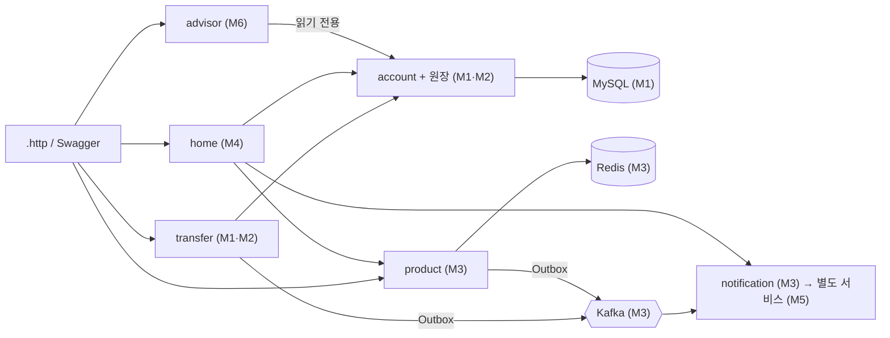

# 코인뱅크 (Kotlin Mini Bank)

기준 계획서: https://claude.ai/artifact/GVXgeXqPr21Z43nDRpiNAs (6주, 11/16 ~ 12/27)

## 목표와 범위
- 만드는 것: 송금, 선착순 특판 적금, 홈 화면 집계, AI 소비 상담을 갖춘 작은 은행 백엔드. 모듈러 모놀리스로 시작해 알림 모듈을 별도 서비스로 떼어낸다.
- 하지 않는 것: 화면(UI), 실제 OAuth·본인인증, 여신 심사, 멀티 노드 Kafka, WebFlux 전면 도입, 클라우드 운영.

## 구조
```
coinbank-ai/
├── build.gradle.kts, settings.gradle.kts    M1
├── docker-compose.yml, .env.example         M1 MySQL·Redis → M2 otel-lgtm → M3 Kafka
├── .github/workflows/ci.yml                 M1
├── http/coinbank.http                       M1 API 시연
├── docs/adr/                                M1부터 계속 (001 원장 모델, 002 모듈 경계)
├── docs/ai-log.md                           M2부터 AI 활용 기록
├── k6/                                      M2 부하 테스트 시나리오
├── src/main/kotlin/com/coinbank/
│   ├── CoinbankApplication.kt               M1
│   ├── ApiExceptionHandler.kt               M1 도메인 예외 → HTTP 응답
│   ├── account/                             M1 계좌 → M2 원장
│   ├── transfer/                            M1 송금 → M2 락·멱등 키
│   ├── product/                             M1 뼈대 → M3 특판 적금
│   ├── notification/                        M1 뼈대 → M3 알림 컨슈머 → M5 삭제
│   ├── home/                                M1 뼈대 → M4 홈 집계
│   └── advisor/                             M6 AI 소비 상담
├── src/test/kotlin/com/coinbank/            M1부터 (@IntegrationTest, Testcontainers, ModularityTests)
└── notification-service/                    M5 분리된 알림 서비스
```

모듈 안의 규칙: 패키지 바로 아래는 공개 API(`AccountService`, `AccountInfo`, `LedgerAudit`, `AccountLock`), `internal/`은 엔티티·리포지토리·컨트롤러. 허용 의존은 각 모듈의 `ModuleMetadata.kt`에 선언한다.



## 기술 스택
- Kotlin 2.3 + JDK 25: 목표 공고가 요구하는 언어. 새로 배우는 핵심.
- Spring Boot 4.1.x (MVC): 익숙한 기반 위에 새 기술을 한 주에 1~2개만 올린다.
- Spring Modulith: 모듈 경계를 테스트로 강제하고 M5 분리의 길을 연다.
- MySQL 8.4 + Spring Data JPA: 익숙한 도구로 락 동작을 깊게 판다.
- Redis 7 + Redisson (M2~M3): 분산 락, 원자적 한도 차감.
- Kafka KRaft 단일 노드 (M3): Outbox, 멱등 컨슈머.
- Coroutines vs Virtual Threads (M4): 같은 API에서 맞비교.
- Spring AI 2.0.x (M6): 읽기 전용 Tool calling.
- JUnit 5, MockK, Testcontainers, k6: 정합성은 실제 MySQL·Redis·Kafka로 증명한다.

## 마일스톤
- [x] M1 Kotlin 수직 슬라이스 (1주차): 송금 1건이 API → DB → 테스트 → CI를 통과한다
- [ ] M2 동시성·정합성 (2주차): 동시 송금 1만 건에서 불일치·중복 0건, 락 3안 비교표
- [ ] M3 특판 적금 + Kafka Outbox (3주차): 초과 개설 0건, 이벤트 유실 0건
- [ ] M4 비동기 홈 집계 (4주차): 순차·Virtual Thread·Coroutine p95 비교표
- [ ] M5 알림 모듈 점진 이관 (5주차): 알림을 별도 서비스로 분리하고 모놀리스 코드 삭제
- [ ] M6 금융 AI + 마무리 (6주차, Could): 읽기 전용 AI 상담, README·회고

## 현재 마일스톤: M2 동시성·정합성
- [x] 1. 동시 송금 테스트로 갱신 유실 재현
- [x] 2. 복식 부기 원장과 "원장 합산 = 잔액" 검사
- [x] 3. 비관 락 + 계좌 번호 정렬로 데드락 방지
- [x] 4. 낙관 락(@Version), 재시도, 락 전략 설정
- [x] 5. Redis 분산 락(Redisson)
- [x] 6. Idempotency-Key 헤더 + 유니크 제약
- [ ] 7. otel-lgtm 관측과 k6 송금 시나리오  ← 지금
- [ ] 8. 락 3안 1만 건 측정, 비교표, ADR(001 확정·003 락 전략·004 멱등 키)
